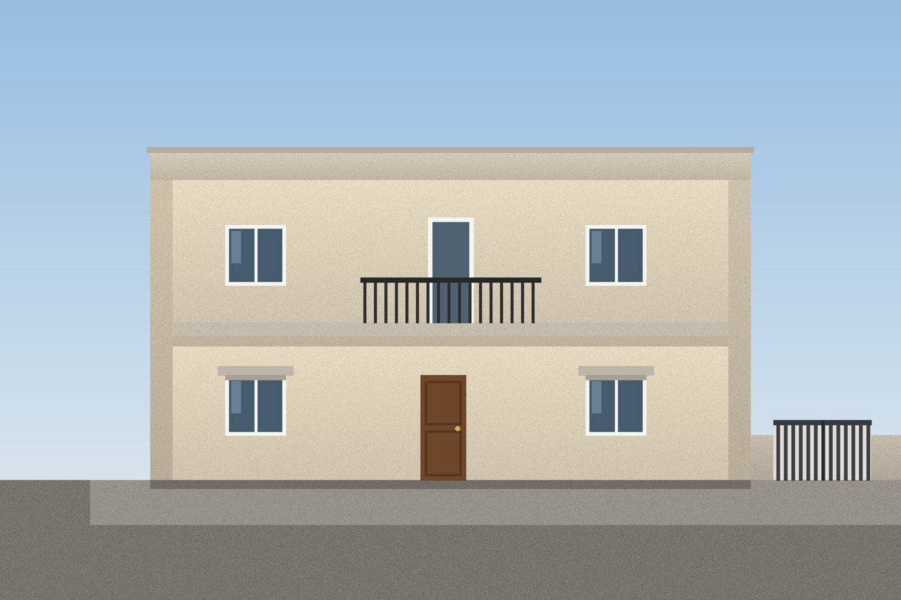
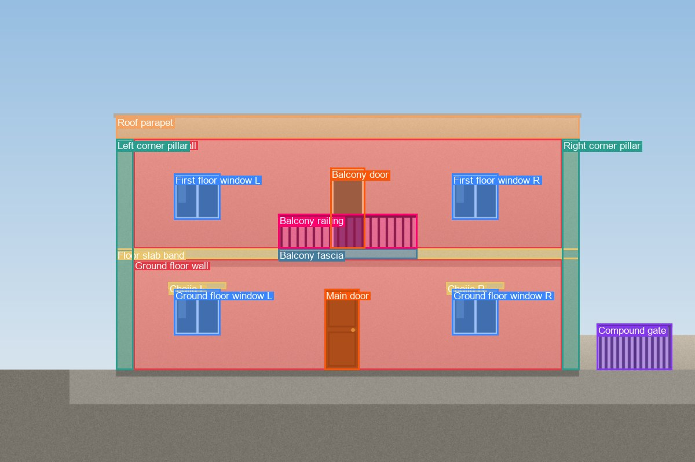
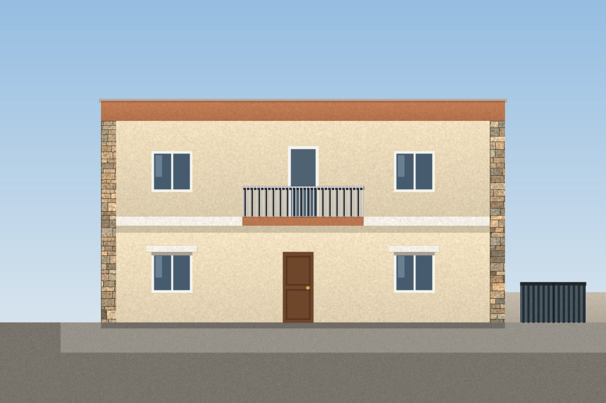
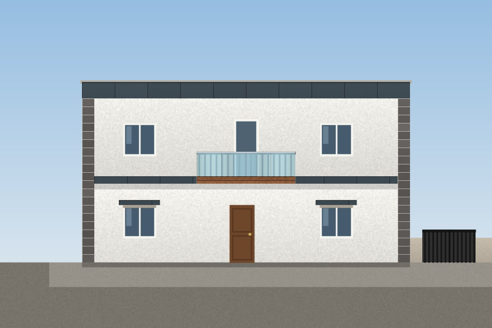
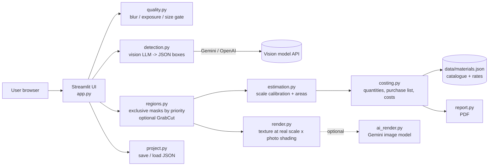

# Exterior Renovation Planner & Cost Estimator

A working prototype for the E2M Solutions *AI-Based Exterior House Renovation & Cost Estimation System* brief.
A homeowner uploads a photo of their house, the system maps the facade into building components, the user
applies materials to each part and compares designs on **their own house**, and the app turns the photo into
surface areas, material quantities and an itemised, editable cost estimate with a downloadable PDF report.

| Original | Component map | Design A: Classic warm | Design B: Modern |
|---|---|---|---|
|  |  |  |  |

*(Bundled synthetic sample house; with an AI key the same flow runs on any uploaded photo.)*

---

## 1. Problem → what the prototype does

| Brief requirement | How it is handled |
|---|---|
| 5.1 Media upload, reject poor input, guide the user | Multi-photo upload. Each photo is scored for resolution, blur (variance of Laplacian), exposure. Unusable photos are rejected with specific tips; the clearest usable photo is pre-selected. |
| 5.2 Identify walls, windows, balconies, pillars, parapets, gates, roof edges; let user review/correct | Vision LLM (Gemini recommended, OpenAI supported) returns typed bounding boxes as strict JSON, validated with Pydantic. A colour-coded map shows exactly what will be measured; every box is editable/addable/deletable in a table with a 10 % grid overlay. |
| 5.3 Material catalogue, different materials per part, multiple combinations | 13 materials (paints, texture, tiles, stone/brick cladding, ACP/WPC panels, glass/SS/MS railings) restricted to the parts they suit, with durability, maintenance and "best for" notes. Unlimited named design options, 4 style presets, colour picker per part. |
| 5.4 Visualise the user's actual house, preserve structure, compare | Geometry-preserving renderer: textures generated at true physical scale (a 300×600 mm tile is drawn at its real size) and multiplied by the photo's own shading. Side-by-side, before/after slider, and all-designs grid with each design's total. Optional photoreal pass via a Gemini image model. |
| 5.5 Surface area estimation | Scale calibration from a standard door, floor count, standard window, or one user measurement; pixel areas converted to sqft, openings deducted, surface factors for hidden faces. |
| 5.6 Quantity calculation | Paint litres (coats, coverage, primer), texture kg, tile count and boxes, panel sheets, cladding sqft, railing running ft, each with wastage. Rounding to whole packs is done once per material in a purchase list. |
| 5.7 Cost estimation with editable rates | Material + labour per line, totals per category, contingency %, GST %, grand total. Every rate, wastage %, coverage and coat count is editable and recalculates instantly. |
| 5.8 Downloadable report | PDF with original and redesigned images, materials (with durability/maintenance), areas, quantities with "how calculated", purchase list, category totals and the estimation method. |
| NFR: re-edit and save projects | Project file (.json) holds photo, components, all designs, rate overrides and settings; reopen from the sidebar. |
| NFR: non-technical users, multiple users | Five-step tabbed flow, plain-language guidance; Streamlit sessions are isolated per browser. |

## 2. Architecture



`core/pipeline.py` wires masks → scale → areas → estimate → render in one Streamlit-free call, so the same logic
can sit behind an API later and is fully unit-tested.

### User workflow

1. **Upload**: add photos (or load the sample). Bad photos are rejected with tips.
2. **Review components**: click *Detect components with AI* (or start blank), then fix boxes in the table.
3. **Design & compare**: pick a material and colour per part, or apply a preset; add more designs and compare.
4. **Measure & cost**: confirm the scale (floors / one measurement), adjust facade multiplier, edit rates.
5. **Report & save**: download the PDF and the project file.

## 3. How the estimation works

**Scale (feet per pixel).** The app collects every reference it can find and shows them side by side:

| Method | Assumption | Reliability |
|---|---|---|
| User measurement | "this wall is 32 ft wide" | best; overrides the others |
| Door | door leaf ≈ 7 ft tall (standard Indian door) | good |
| Floor count | ≈ 10 ft floor-to-floor | fair |
| Window | ≈ 4 ft tall | weakest (sizes vary) |

If references disagree by more than 35 % the app warns that the photo may be at an angle. With no reference at
all it falls back to "the photo spans ~40 ft" and says so loudly.

**Areas.** Boxes become exclusive pixel masks using a priority order (railing > openings > gate > pillar > balcony >
roof edge > parapet > wall), so a window is cut out of the wall behind it and nothing is counted twice.
`area_sqft = pixels × (ft_per_px)²`, then multiplied by a surface factor for faces the photo cannot show:

| Component | Factor | Why |
|---|---|---|
| Wall | ×1 | the photographed face |
| Parapet | ×2 | inner and outer face |
| Pillar | ×3 | engaged column: front + 2 sides |
| Roof edge / chajja | ×1.5 | front + soffit |
| Gate | ×2 | both sides |
| Railing | running ft × 3.5 ft height | length matters for pricing |

A facade multiplier (default 1) extends the front elevation to other sides of the house. All factors are editable.

**Quantities.**
- Paint: `litres = area × coats ÷ coverage × (1 + wastage)` + one primer coat.
- Texture: `kg = area ÷ coverage × (1 + wastage)`.
- Tiles: `pieces = area × (1 + wastage) ÷ tile area`, then boxes.
- Panels: sheets or planks = `area × (1 + wastage) ÷ panel area`.
- Cladding: sqft with wastage. Railings: running ft with wastage.

Each component keeps its exact quantity. A purchase list then rounds up **once per material** to whole litres,
boxes or sheets. Two 4.5 sqft chajjas in ACP share one sheet instead of buying one each, and the rounding
amount is shown separately.

**Cost.** `material = purchased qty × rate`, `labour = finished sqft (or running ft) × labour rate`, then
contingency % and GST % on top. Default rates are indicative Indian 2026 rates (`data/materials.json`) and
every one can be edited in the app.

**Accuracy check.** The bundled sample has known dimensions (20 px = 1 ft). All three scale references recover
20.0 px/ft, and the computed wall areas match the hand-calculated values exactly. Example: ground floor wall
37 × 9.6 ft − 2 windows − door − 2 chajjas = 296.2 sqft (see `tests/test_core.py`).

### Detection quality (live Gemini run on the sample house)

Boxes are compared with the known layout (IoU = overlap ÷ union of the predicted and true box):

| Model | Components found | Typical IoU | Scale recovered (true 20.0 px/ft) |
|---|---|---|---|
| `gemini-3.5-flash` (default) | 16 of 17 | 0.85–0.99 (walls, windows, doors, pillars, railing, gate, parapet); chajjas 0.74; slab band 0.56 | 19.86–19.93 |
| `gemini-2.5-flash` (fallback) | many fragments | mostly < 0.4 | 12.6 (37 % off) |

That is why the default is `gemini-3.5-flash`, with `gemini-2.5-flash` used only when the primary model is
overloaded. The thin balcony fascia is the one part it misses; the review step exists for exactly this.

## 4. Design decisions and trade-offs

- **LLM for detection, user as the final authority.** A general vision model gives a usable first map with no
  training data. Boxes are imperfect, so the review table is a first-class step rather than an afterthought,
  and the overlay shows exactly which pixels will be priced.
- **Boxes, not polygons.** Vision LLMs return boxes far more reliably than polygons, and boxes are easy for a
  homeowner to correct. Priority-based masking recovers most of the precision (openings are subtracted).
  Optional GrabCut refinement tightens loose wall boxes; in testing it reduced a 44 % over-estimate to −19 %, so
  it is off by default and marked experimental.
- **Deterministic renderer as the source of truth.** Generative image editing looks nicer but can move windows
  or change proportions, which would break the link between the picture and the measured areas. The
  deterministic render keeps geometry pixel-exact, is free, fast (~0.3 s) and works offline. The Gemini
  photoreal pass is optional and labelled "artist's impression".
- **Transparent maths over a black box.** Every number in the estimate has a "how calculated" note, and every
  assumption (door height, surface factors, rates) is visible and editable. That transparency is what makes
  the estimate usable as a discussion document with a contractor.
- **Works without an API key.** The bundled sample house and manual box entry let anyone evaluate the full flow.
  A hosted key can be protected with an access code and a per-session call cap. Visitors can also paste their
  own key, which is kept only in their session.
- **Streamlit** keeps the prototype in one deployable Python app. `core/` has no UI dependency, so a FastAPI
  service or React front-end can reuse it unchanged.

## 5. Limitations

- **Single photo, single elevation.** Side and rear walls are not seen. The facade multiplier is a rough proxy.
- **Perspective.** The photo is assumed to be roughly front-on. Angled shots compress far walls and skew areas.
  There is no perspective rectification yet.
- **Detection quality depends on the model** (see the table above). Not fine-tuned for Indian residential facades. Trees, cars and
  wires can confuse it. Users must review the map.
- **Boxes over-cover irregular shapes** (sloped roofs, curved balconies) unless the user splits them.
- **Renderer realism.** Textures are procedural and lighting is approximated from the photo's luminance. Strong
  shadows and very dark original colours reduce realism.
- **Rates are indicative** and not region-specific. No live supplier pricing.
- **Not covered:** surface preparation (crack filling, waterproofing, putty), scaffolding, removal of old
  cladding. These belong in contingency until added as line items.
- The optional photoreal pass needs a Gemini key with billing enabled: image models have no free-tier quota.
  Detection works on the free tier.
- Live detection has been measured on the bundled sample only (see *Detection quality* below). It still needs an
  evaluation set of real, tape-measured houses.

## 6. Next steps

1. Run live detection on a set of real facade photos and tune the prompt. Add a small evaluation set (IoU of
   boxes, % error of areas against tape-measured houses).
2. Segmentation model (e.g. SAM-style promptable segmentation seeded by the LLM boxes) for pixel-accurate masks.
3. Perspective correction from vertical/horizontal vanishing lines, and multi-photo stitching for all sides.
4. City-wise rate cards and supplier integration; surface-prep and scaffolding line items.
5. User accounts with server-side project storage; FastAPI service behind the UI for contractor integrations.
6. Usage/cost telemetry for AI calls (tokens, latency) and response caching per image hash.

## 7. Run locally

Requires Python 3.11+ (built and tested on 3.13).

```powershell
cd E2M_AI_Assessment
python -m venv .venv
.\.venv\Scripts\Activate.ps1
pip install -r requirements-dev.txt
copy .env.example .env     # then paste a GEMINI_API_KEY (optional)
streamlit run app.py
```

Open http://localhost:8501. Without a key, click **Load the sample house**.

### Tests

```powershell
python -m pytest -q
```

28 tests (one live, opt-in with `RUN_LIVE_TESTS=1`) cover masking, scale calibration, area ground truth, quantity formulas, purchase rounding, totals,
LLM-output parsing (fenced JSON, synonyms, retries, API errors), the quality gate, project save/load, PDF
generation, render isolation, and three headless end-to-end UI flows (Streamlit `AppTest`).

### Configuration (`.env` or host secrets)

| Variable | Purpose |
|---|---|
| `GEMINI_API_KEY` | enables AI detection (recommended) and the optional photoreal pass |
| `OPENAI_API_KEY` | alternative detection provider |
| `GEMINI_MODEL`, `GEMINI_FALLBACK_MODELS`, `GEMINI_IMAGE_MODEL`, `OPENAI_MODEL` | model overrides (defaults: `gemini-3.5-flash`, fallback `gemini-2.5-flash`) |
| `APP_ACCESS_CODE` | if set, visitors need this code to use the hosted key |
| `AI_CALLS_PER_SESSION` | cap on hosted-key calls per browser session (default 12) |

## 8. Deploy

See [DEPLOY.md](DEPLOY.md) for Streamlit Community Cloud (recommended), Hugging Face Spaces and Render.

## Project layout

```
app.py                 Streamlit UI (5-step flow)
core/
  quality.py           upload decoding + quality gate
  detection.py         vision-LLM component detection, JSON validation
  regions.py           component model, exclusive masks, GrabCut refine
  estimation.py        scale calibration, surface areas
  costing.py           quantities, purchase list, cost estimate
  render.py            geometry-preserving material renderer, overlays
  ai_render.py         optional Gemini photoreal pass
  report.py            PDF report
  project.py           save / load project JSON
  presets.py           style presets
  sample.py            synthetic house with known dimensions
  pipeline.py          one-call orchestration (UI-free)
data/materials.json    material catalogue and indicative rates
tests/                 unit + end-to-end tests
Dockerfile, render.yaml, .streamlit/   deployment config
```
